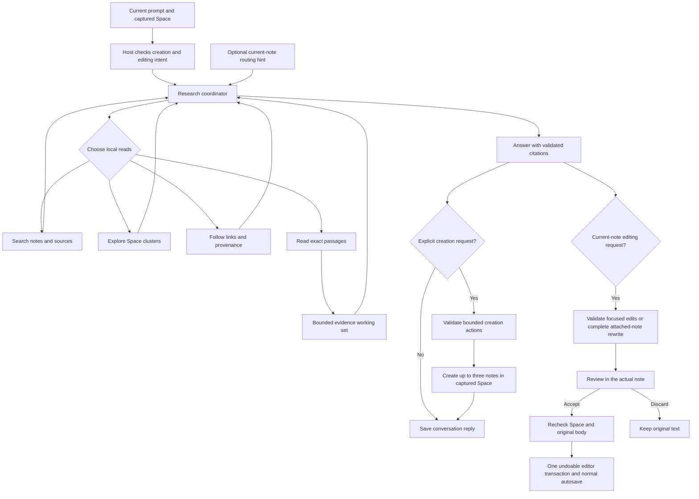

# Chat beside the document

The bottom-right chat circle and full Chat route share one mounted conversation
and the active Space's existing `studio.messages`. The circle is available when
the selected provider is configured, independently of the editor's AI tools.
Flow hides it. Closing the panel preserves the draft and ongoing response;
changing Spaces resets transient UI and selects that Space's history.

The circle uses the same Regular native material as the editor toolbar, clipped
to a 46-point circle. Its paint-only overlay has an independent per-window
sequence receipt, so editor and chat updates cannot hide each other. DOM controls
retain input and accessibility. The live conversation uses a restrained frosted
CSS panel with solid accessibility fallbacks; its text is never rasterized.

## Agent topology

This reuses `chatReading.ts` rather than adding another agent service or history
schema. One coordinator adaptively chooses its next reads. It can inspect four
read requests per step, up to six provider steps and three minutes. Each step
gets a fresh bounded packet: at most 24 routing entries, 12 exact passages of
3,000 UTF-16 units, and 96,000 encoded bytes. These are ceilings, not reading
targets. Search and relationship results guide discovery; only exact passages
are evidence. Partial coverage remains visible on the answer.

Current-note context is resolved against the captured Space, displayed beside
the composer, and retained when a drafted question expands into full Chat.
Ordinary Chat contains a bounded directory entry. If the agent chooses a broad
revision, the next reading step attaches only that note’s complete bounded
authored body. There is no mode selector or separate intent-classifier call.
The agent must request an exact read before citing that note. A foreign or
missing ID supplies no context.

The renderer and native host independently derive creation authority from the
current user prompt. Reading steps never apply note actions. Only a valid final
answer can create notes after validation. Existing-note edits use a separate
current-note permission and an explicit local Accept changes action; deletion is unavailable.
Imported material, note titles, historical conversation and model output cannot
grant permission. Cancellation or changed captured knowledge prevents late
commits. Existing Keep as note and passage/provenance preservation are shared by
both conversation presentations.

## Editing the current note

A requested rewrite, correction, expansion or other text change uses the same
adaptive research coordinator. It first reads exact passages from the captured
current note. The final response can propose up to eight unique, disjoint exact
replacements; each side is bounded to 6,000 code points and the total to 24,000.
The host binds the proposal to the original Space, note and body. The provider
cannot supply a destination ID. Metadata, control comments and retained evidence
are protected. Reading responses cannot carry usable edits.

The composer attaches a Space-local note. The agent infers whether to answer,
propose a focused change, or revise the whole note from the request and relevant
conversation. It can follow “yes, do that” without English keyword matching.
An `editIntent` plan never grants write authority: only local acceptance does.
Questions, critique and negated edits stay conversational. Truly unclear requests
get a natural clarification rather than an editing-mode picker.

A broad revision first requests the attached note's complete authored body
(maximum 24,000 code points / 72,000 encoded bytes), then returns a bounded
`noteRewrite`. An oversized note returns an explicit unavailable result so the
agent can work on exact sections and disclose its scope without truncating the
original. Focused edits still require exact passage reads. The host retains
frontmatter and generated evidence footers. Existing replies can be converted
through one Use in note action; overly long replies ask for a direct edit request
instead of silently truncating the reference draft.

Review in note opens the normal editor and decorates its unchanged document.
Removed text is highlighted and struck through, additions appear in gray,
and untouched text retains its normal appearance. Heavily rewritten paragraphs
use whole-passage comparisons to avoid a jumble of alternating words. The review
bar offers Accept changes and Discard. Review is transient and read-only; it
never appears in Markdown, autosave or export. Accept applies one undoable rich
transaction through ordinary autosave. Discard leaves the original alone.
External body changes invalidate the review. Flow, dictation and active inline
operations prevent staging. There is no new persisted schema or vault writer.

## Verification

`ChatDock.test.tsx` covers provider/Flow gating, Space remounts, draft and pending
request preservation, Stop, Escape focus restoration, IME confirmation and
current-note context through expansion. `chatReading.test.ts` exercises exact
evidence, invalid IDs, cancellation, stale knowledge, bounded reads and
creation-only finalization. Native ruler-glass tests bound the separate chat
surface and retain the editor's existing sequence/geometry checks.

`chatEdits.test.ts` covers authority, exact evidence, edit limits, ambiguity,
protected metadata/evidence, Space isolation and stale bodies.
`ChatEditPreview.test.tsx` covers Review in note, Discard and stale/error states.
`NoteView.chatEdits.test.tsx` exercises preview-to-editor application, parent
save echoes, gray/highlighted decorations, full rewrites, discard, external
updates and Undo through the actual rich editor. `ChatNoteReview.test.ts` covers
word, paragraph, list, table, Unicode and formatting differences without
preview writes or history entries. Native tests verify
separate edit schemas and read-step/unauthorized edit suppression.
